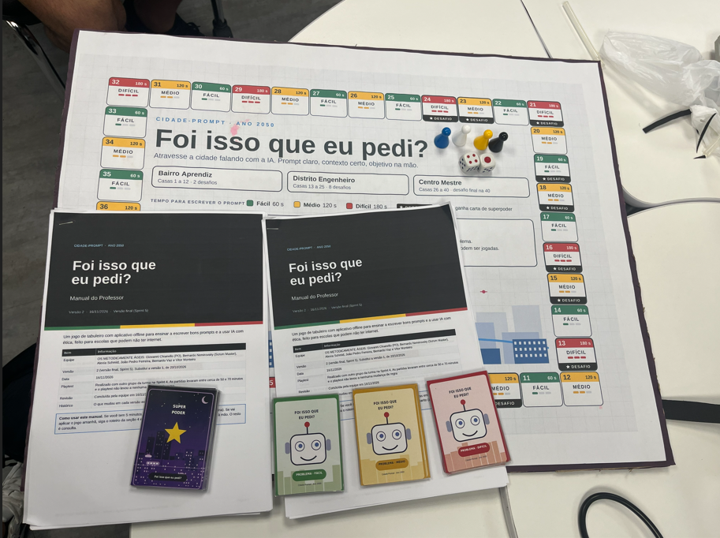

# Foi isso que eu pedi?

Jogo de tabuleiro analógico + validador de prompts offline para ensinar **Engenharia de Prompt Ética** em escolas sem internet ou com conexão ruim.

Projeto em grupo da disciplina **Métodos Ágeis de Desenvolvimento de Software** (Ibmec), feito pela equipe **Os Metodicamente Ágeis** com o framework **ScrumBan**, entre 29/09 e 17/11/2026.



## Como o projeto surgiu

Este não é um produto de mercado: é um **projeto de faculdade**. O professor apresentou um desafio, e a turma tinha de resolvê-lo trabalhando como um time ágil, com evidências visíveis do processo.

- **O desafio:** mais de 8 mil escolas brasileiras não têm acesso à internet. Como ensinar a usar IA generativa sem estar na "nuvem"? A resposta pedida foi o design lúdico: um jogo analógico com suporte digital offline.
- **O que foi pedido:** (1) um jogo físico funcional (cartas, tabuleiro, dados) e (2) um protótipo de alta fidelidade de um "validador de prompts" que funcione offline e simule uma IA.
- **Como foi pedido:** executar tudo em ScrumBan, com quadro Kanban (Backlog, A Fazer, Fazendo, Feedback e Pronto), limite de WIP, planejamento, weeklies, revisão e retrospectiva a cada sprint, e Definição de Pronto.

A história completa, com o material de apoio da disciplina, está em [docs/origem-do-projeto.md](docs/origem-do-projeto.md).

## O que a equipe entregou

### Jogo físico: Cidade-Prompt, ano 2050
Os jogadores escolhem um dos **4 robôs** e atravessam a cidade falando com a IA: do Bairro Aprendiz ao Distrito Engenheiro e ao Centro Mestre. Cada casa traz um desafio de **nível fácil, médio ou difícil**, com tempo limitado para escrever o prompt, e há **cartas de superpoder** para virar a partida.

| Peça | Arquivo |
| --- | --- |
| Tabuleiro A3 (v2) | [jogo-fisico/Tabuleiro_A3_v2.pdf](jogo-fisico/Tabuleiro_A3_v2.pdf) |
| Cartas de problema (v3) | [jogo-fisico/Cartas_de_Problema_v3.pdf](jogo-fisico/Cartas_de_Problema_v3.pdf) |
| Cartas de superpoder (v3) | [jogo-fisico/Cartas_de_Superpoder_v3.pdf](jogo-fisico/Cartas_de_Superpoder_v3.pdf) |
| Versos das cartas | [jogo-fisico/04_Versos.pdf](jogo-fisico/04_Versos.pdf) |
| Peças dos 4 robôs | [jogo-fisico/Pecas_Robos.png](jogo-fisico/Pecas_Robos.png) |
| Ficha do avaliador | [jogo-fisico/06_Ficha_Avaliador.pdf](jogo-fisico/06_Ficha_Avaliador.pdf) |

O design das mecânicas se baseia nos **padrões de design de jogos** de Björk, Lundgren e Holopainen (2003): ver [docs/Mecanicas_de_Bjork.pdf](docs/Mecanicas_de_Bjork.pdf).

### Manual do Professor
Regras e passo a passo da aula, para o professor conduzir o jogo sem treinamento prévio: [manual-do-professor/Manual_do_Professor_v2.pdf](manual-do-professor/Manual_do_Professor_v2.pdf).
Há também um vídeo de apresentação em [video-de-apresentacao/](video-de-apresentacao/).

### Validador de prompts offline
Um único arquivo HTML que roda no navegador, **sem nenhuma chamada à internet**, e simula a avaliação de uma IA: compara o prompt com o gabarito do desafio, calcula a nota e aponta o que melhorar. Também alerta sobre **dados sensíveis** (como CPF), **vieses** e boas práticas de **LGPD**.

Para usar, baixe [validador-offline/validador-v2.html](validador-offline/validador-v2.html) e abra no Chrome ou no Safari.

## O processo (ScrumBan)

| Documento | Conteúdo |
| --- | --- |
| [docs/processo-scrumban.md](docs/processo-scrumban.md) | Equipe, visão do produto, quadro Kanban, limites de WIP, pontos e Definição de Pronto |
| [docs/roadmap-e-backlog.md](docs/roadmap-e-backlog.md) | Temas, épicos e histórias de usuário |
| [docs/sprints.md](docs/sprints.md) | As 5 sprints: objetivo, histórias, weeklies, revisão e retrospectiva |
| [docs/roadmap-e-visao-do-produto.csv](docs/roadmap-e-visao-do-produto.csv) | Exportação do board do Miro |

O quadro Kanban foi mantido no Notion e o roadmap no Miro, ambos com acesso restrito ao grupo.

## Equipe: Os Metodicamente Ágeis

| Papel | Pessoa |
| --- | --- |
| Product Owner | Giovanni |
| Scrum Master | Bernardo N. |
| Desenvolvedores | Alexia, Vitor, Bernardo V. e João Pedro Ferreira Afonso |

### Minha contribuição (João Pedro Ferreira Afonso)

Como desenvolvedor, trabalhei principalmente no **conteúdo pedagógico do jogo** e no **validador**:

- **Sprint 2:** descrevi os 5 elementos do prompt com exemplos de prompt bom e ruim, listei os conceitos de estrutura de prompt, escolhi os padrões de design de Björk e documentei a proposta de mecânicas, transformando cada técnica em desafios de carta.
- **Sprint 3:** incluí no jogo conceitos, dores, necessidades, localização e documentos como elementos do prompt e escrevi as cartas de contexto.
- **Sprint 4:** desenvolvi o validador que compara o prompt com o gabarito e dá a nota, além das mensagens de feedback, da tela de resultado e da identidade visual do app.
- **Sprint 5:** revisei o texto e o layout, preparei a versão final do Manual do Professor e deixei o validador 100% offline.
- **Todas as sprints:** registrei as weeklies e participei das reuniões de planejamento, revisão e retrospectiva.

## Estrutura do repositório

```
foi-isso-que-eu-pedi/
├── jogo-fisico/          tabuleiro, cartas, versos, robôs e ficha do avaliador
├── manual-do-professor/  manual em PDF
├── validador-offline/    validador de prompts (HTML único, offline)
├── video-de-apresentacao/ vídeo de apresentação do manual
└── docs/                 origem do projeto, processo ScrumBan, roadmap, sprints e imagens
```

## Créditos e material de terceiros

O desafio, os slides de processo e a régua de motivadores de exemplo em `docs/material-de-referencia/` pertencem ao professor e à disciplina (Ibmec), e a figura da estrutura de prompt é de Bibliotecas Duoc UC. Estão aqui só para contar como o projeto surgiu. O jogo, o manual, o validador e a documentação do processo são trabalho da equipe.
