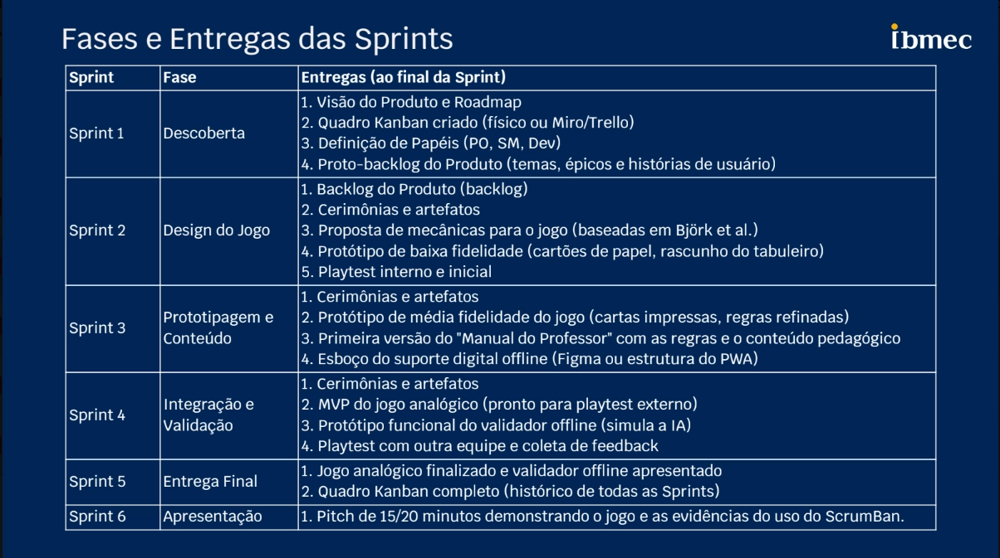
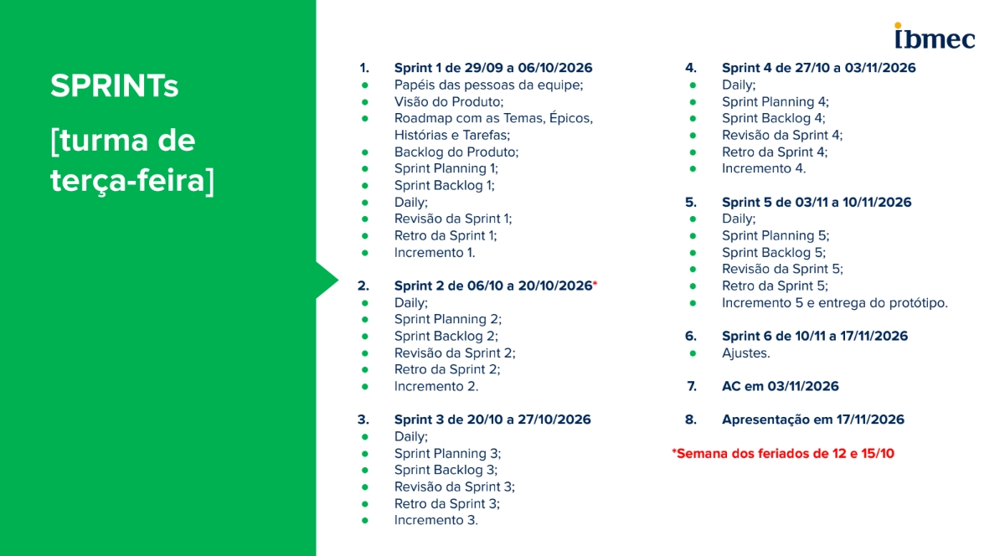
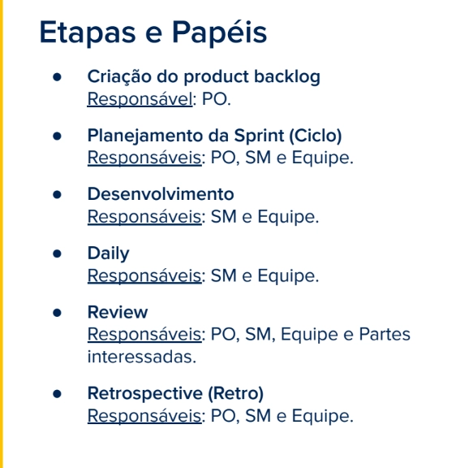
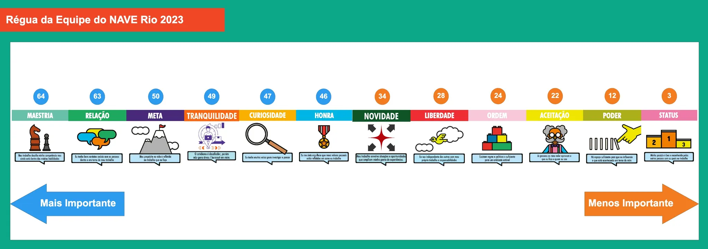

# Como o projeto surgiu

"Foi isso que eu pedi?" nasceu como trabalho da disciplina **Métodos Ágeis de Desenvolvimento de Software**, no Ibmec. O professor propôs um desafio real e pediu que a turma o resolvesse trabalhando como uma equipe ágil. Aqui está o contexto.

## O desafio

O Brasil ainda tem mais de 8 mil escolas sem acesso à internet e mais de 32 mil sem informação sobre a qualidade da conexão. Milhões de estudantes ficam de fora do aprendizado de como usar ferramentas de IA generativa.

O desafio foi desenvolver **uma solução gamificada (jogo analógico + suporte digital offline)** para ensinar os fundamentos da **Engenharia de Prompt Ética** a estudantes e professores de escolas sem conectividade ou com conexão ruim. O foco não era tecnologia de ponta, mas criatividade, lógica e pedagogia (aprender fazendo). A pergunta orientadora: como aprender algo que depende da "nuvem" sem estar na nuvem? A resposta sugerida era o **design lúdico**.

## O que o jogo deveria ensinar

- **Técnicas de prompting:** estrutura, contexto, persona, tarefa, formato, instrução objetiva, conceitos, dores, necessidades, localização e documentos.
- **Ética:** identificar vieses, dados sensíveis e boas práticas no uso de IA, observando a LGPD.
- O design do jogo deveria usar como base os **padrões de design de jogos** de Björk et al. (2003).

## Os dois entregáveis pedidos

1. **Jogo físico:** protótipo funcional (cartas, tabuleiro, dados) que possa ser usado sem internet.
2. **Aplicação offline:** protótipo de alta fidelidade (Figma, Adobe XD ou site) de um "validador de prompts" que funcione offline, simulando uma IA, seja como PWA ou como lógica de gabarito que compara a resposta do jogador com um padrão esperado.

## Como o trabalho deveria ser feito: ScrumBan

O projeto foi executado com **ScrumBan**, a fluidez do Kanban com a estrutura do Scrum. Todas as evidências deveriam estar visíveis em um quadro Kanban, com:

- colunas Backlog, A Fazer, Fazendo, Feedback e Pronto;
- limite de trabalho em progresso (WIP) para evitar gargalos;
- planejamento das sprints, weeklies (daily adaptada, 1 ou 2 reuniões rápidas por semana), revisão e retrospectiva em formato Keep/Stop/Start;
- uma Definição de Pronto (DoD): o item só está pronto se foi executado, revisado por alguém da equipe, documentado no Kanban e atende aos critérios de aceite da sprint.

### Fases e entregas previstas por sprint

| Sprint | Fase | Entregas ao final |
| --- | --- | --- |
| 1 | Descoberta | Visão do produto e roadmap (Miro), quadro Kanban criado, papéis (PO, SM, Devs) e proto-backlog |
| 2 | Design do jogo | Backlog do produto, mecânicas baseadas em Björk, protótipo de baixa fidelidade e playtest interno inicial |
| 3 | Prototipagem e conteúdo | Protótipo de média fidelidade (cartas impressas, regras refinadas), primeira versão do Manual do Professor e esboço do suporte digital offline |
| 4 | Integração e validação | MVP do jogo analógico, protótipo funcional do validador offline e playtest com outra equipe |
| 5 | Entrega final | Jogo finalizado, validador apresentado e quadro Kanban completo com o histórico de todas as sprints |
| 6 | Apresentação | Pitch demonstrando o jogo e as evidências do ScrumBan |

A turma de terça-feira, a da nossa equipe, teve a Sprint 1 de 29/09 a 06/10/2026 e a apresentação em 17/11/2026. As datas de cada sprint estão em [sprints.md](sprints.md).

## Como a equipe respondeu

A equipe, **Os Metodicamente Ágeis**, organizou o trabalho em um quadro no Notion, montou o roadmap e a visão do produto no Miro e entregou o jogo **Cidade-Prompt** com o validador offline. O detalhe do processo está em [processo-scrumban.md](processo-scrumban.md), e o resultado final está no [README](../README.md).

## Material de apoio da disciplina

Estes arquivos são do professor e da disciplina, ou de terceiros. Estão em `docs/material-de-referencia/` só como contexto.

| Arquivo | O que é |
| --- | --- |
| `fases-e-entregas-das-sprints.png` | Slide do professor com as fases e entregas de cada sprint |
| `quadro-sprints.png` | Slide do professor com o calendário de sprints da turma de terça-feira |
| `papeis-da-equipe.png` | Slide do professor com as etapas e os responsáveis no Scrum |
| `moving-motivators.png` | Régua de motivadores (Moving Motivators) da equipe do NAVE Rio 2023, deixada pelo professor no quadro do Notion como exemplo |
| `revisao-sprint3.jpeg` | Foto de uma figura de Bibliotecas Duoc UC sobre a estrutura avançada de um prompt (contexto, audiência, instrução, tom, detalhes, formato, estrutura, palavras-chave e extensão), usada como referência de conteúdo |

